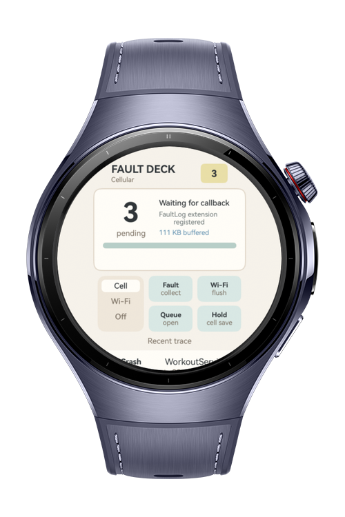
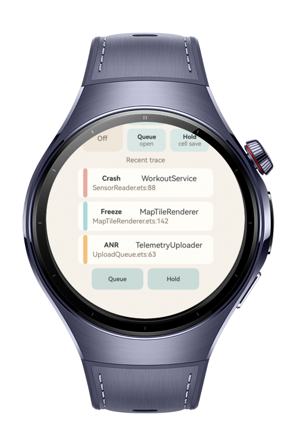
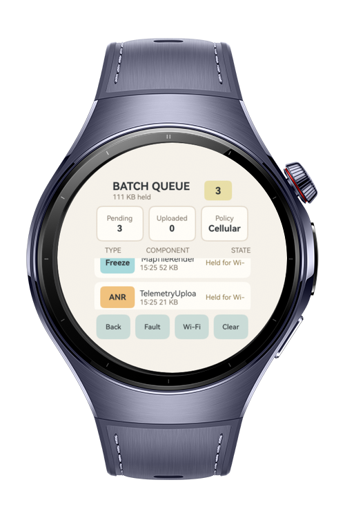

> **Note:** To access all shared projects, get information about environment setup, and view other guides, please visit [Explore-In-HMOS Index](https://github.com/Explore-In-HMOS/hmos-index).

# How to Build Fault Log Extension

This app is a wearable fault notification service that processes crash, freeze, and ANR reports in the background. It uses `FaultLogExtensionAbility` and `FaultLogExtensionContext` to collect delayed fault reports, batch telemetry, generate readable summaries with stack traces and device state, and queue uploads until the watch reconnects to Wi-Fi.

# Preview

<div>
  
  
  
</div>

# Use Cases

- Background fault report collection with `FaultLogExtensionAbility`
- Extension runtime lifecycle access with `FaultLogExtensionContext`
- Delayed crash, freeze, and ANR processing with `onFaultReportReady()`
- Human-readable fault summaries with stack trace and device state
- Wi-Fi based telemetry queue to reduce cellular data usage

# Tech Stack

- **Languages**: ArkTS, ArkUI
- **Frameworks**: HarmonyOS SDK 6.0.1(21)
- **Tools**: DevEco Studio 6.0.1, Hvigor
- **Libraries**:
    - `@kit.ArkUI`
    - `@kit.ArkTS`
    - `@kit.AbilityKit`
    - `@kit.PerformanceAnalysisKit`

# Directory Structure

```
entry/src/main/ets/
├───entryability
│       EntryAbility.ets
├───faultlog
│       FaultCollectorExtension.ets
├───model
│       FaultLogCollector.ets
├───pages
│       Index.ets

```

# Constraints and Restrictions

## Supported Device

* Huawei Watch 5
* HarmonyOS wearable emulator

# License

**How to Build Fault Log Extension** is distributed under the terms of the MIT License. See the [LICENSE](LICENSE) for more information